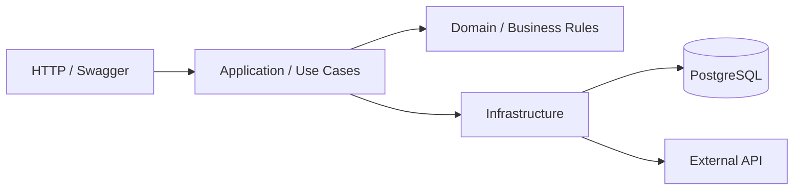

# Project Name

A REST API designed to manage resources, business operations, and integrations with external services.

The application focuses on maintainability, scalability, reliability, and separation of responsibilities.


<!-- Replace test and coverage badges with real CI indicators when available. -->

## Stack


## Overview

This project demonstrates the implementation of a REST API using a layered architecture.

The application separates business rules, application services, and infrastructure concerns.

## Architecture



<!-- Optional: use pre-generated SVG diagrams for custom light/dark themes.

<picture>
  <source
    media="(prefers-color-scheme: dark)"
    srcset="./docs/architecture-dark.svg"
  />
  
</picture>

-->

## Key Features

- RESTful API design
- Request validation
- Business rule enforcement
- Database persistence
- External service integration
- Error handling
- API documentation
- Unit and integration tests
- Docker-based development environment

## Prerequisites

Make sure Docker and Docker Compose are installed and the Docker engine is running.

## Run Locally

1. Clone the repository:

```bash
git clone git@github.com:USERNAME/REPOSITORY.git
cd REPOSITORY
```

2. Create your environment file:

```bash
cp .env.example .env
```

3. Configure the required values:

```env
NODE_ENV=development
PORT=3000

DATABASE_URL=postgresql://user:password@db:5432/app

EXTERNAL_API_KEY=
EXTERNAL_API_URL=
```

4. Start the application:

```bash
docker compose up --build
```

- API: `http://localhost:3000`
- Health: `http://localhost:3000/health`
- Swagger: `http://localhost:3000/api/docs`

## Endpoints

| Method | Route | Description |
| --- | --- | --- |
| `POST` | `/api/items` | Create an item |
| `GET` | `/api/items` | List items |
| `GET` | `/api/items/:id` | Get an item by ID |
| `PUT` | `/api/items/:id` | Update an item |
| `DELETE` | `/api/items/:id` | Delete an item |

## External Integrations

| Service | Purpose | Protocol |
| --- | --- | --- |
| External API | Resource synchronization | REST |
| Webhook Provider | Event notifications | HTTP |
| PostgreSQL | Data persistence | TCP |

## Example Request

```bash
curl -X POST http://localhost:3000/api/items \
  -H "Content-Type: application/json" \
  -d '{
    "name": "Example item",
    "description": "Example description"
  }'
```

## Example Response

```json
{
  "id": "123",
  "name": "Example item",
  "description": "Example description",
  "createdAt": "2026-01-01T12:00:00Z"
}
```

## Project Structure

```text
src/
├── application/
│   ├── dto/
│   └── use-cases/
├── domain/
│   ├── entities/
│   └── interfaces/
├── infrastructure/
│   ├── database/
│   ├── http/
│   └── integrations/
├── shared/
└── main.ts
```

## Tests and Build

Run unit tests:

```bash
docker compose exec api npm test
```

Run integration tests:

```bash
docker compose exec api npm run test:e2e
```

Generate coverage:

```bash
docker compose exec api npm run test:cov
```

Build the application:

```bash
docker compose exec api npm run build
```

## Technical Highlights

- Separation of business rules and infrastructure
- Dependency injection
- Consistent error handling
- Database migrations
- Environment-based configuration
- Automated testing
- API contract documentation

## Demo


## License

This project is licensed under the MIT License.
