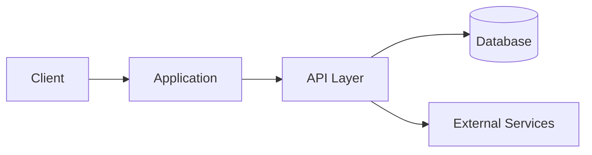

# Project Name

A short description of the application, its purpose, and the problem it solves.

Additional context about the project, its motivation, or development history.


## Stack


## Architecture



## Features

- User-friendly interface
- Responsive layout
- CRUD operations
- External API integration
- Data persistence
- Error handling and validation

## Prerequisites

Make sure Docker and Docker Compose are installed and the Docker engine is running.

## Run Locally

1. Clone the repository:

```bash
git clone git@github.com:USERNAME/REPOSITORY.git
cd REPOSITORY
```

2. Create your environment file:

```bash
cp .env.example .env
```

3. Configure the required values:

```env
APP_PORT=3000
DATABASE_URL=
API_KEY=
```

4. Start the application:

```bash
docker compose up --build
```

- Application: `http://localhost:3000`

## Project Structure

```text
src/
├── app/
├── components/
├── services/
├── lib/
└── types/
```

## Tests and Build

```bash
npm test
npm run build
```

## Demo


